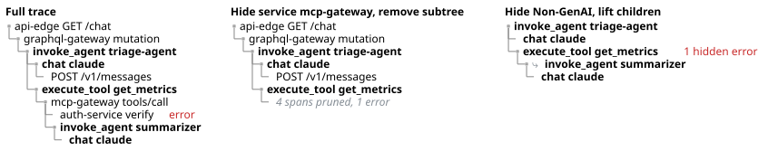
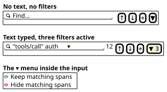
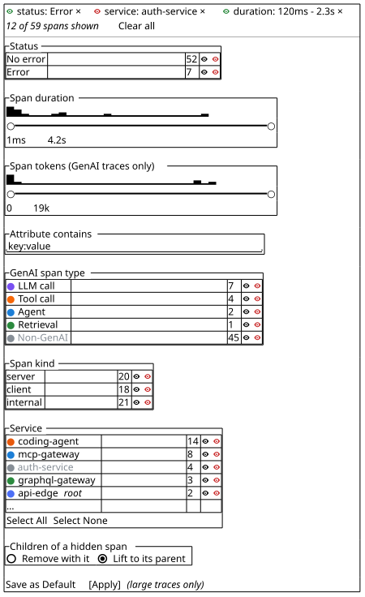
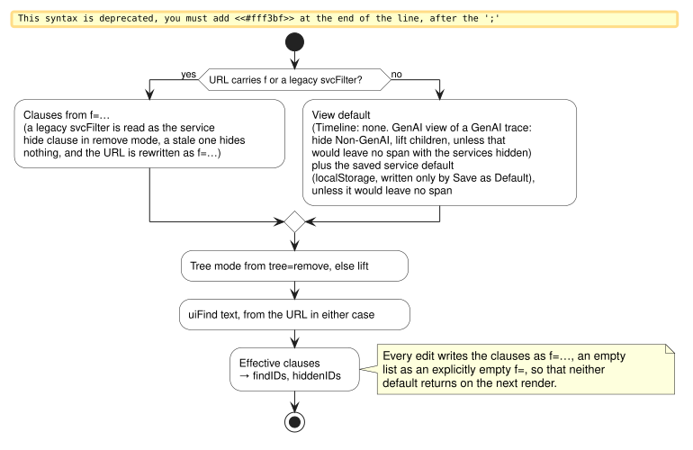
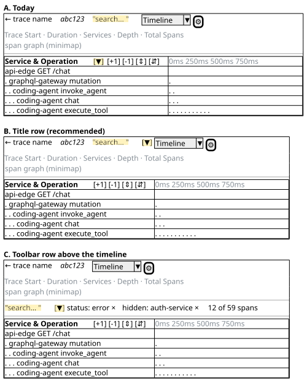

# RFC 0009: Find, Keep and Hide: One Criterion Vocabulary for Spans in the Trace View

* **Status**: Draft
* **Created**: 2026-11-08
* **Last Updated**: 2026-11-10
* **Related**: [ADR-0009](../adr/0009-service-filter-trace-timeline.md) (service filter), [#4606](https://github.com/jaegertracing/jaeger-ui/issues/4606), [#4272](https://github.com/jaegertracing/jaeger-ui/issues/4272), [#4580](https://github.com/jaegertracing/jaeger-ui/issues/4580), [#3815](https://github.com/jaegertracing/jaeger-ui/issues/3815), [#651](https://github.com/jaegertracing/jaeger-ui/issues/651), [#4312](https://github.com/jaegertracing/jaeger-ui/pull/4312)
* **Figures**: PlantUML sources in [`0009/`](./0009/), rendered to SVG by [`0009/render.sh`](./0009/render.sh) with the PlantUML Docker image

## TL;DR

The trace page has two ways to narrow a trace that do not know about each other. The search box in the page header highlights the spans whose text matches, and the funnel in the "Service & Operation" column header removes the spans of unselected services together with their subtrees. Each has its own matching code, its own vocabulary, its own URL parameter and its own place on the screen, and every request to narrow the tree by something else (span status, span kind, GenAI span type, duration, an attribute value) has to pick one of the two to extend.

Search and filter are not the same thing to the user. Search asks "where is it?" and wants the rest of the trace kept as context. Filter asks "what is left without it?" and wants the rest gone. What they share is the **criterion**: "spans whose status is error", "spans of service X", "spans longer than 2 s". This RFC proposes one vocabulary of criteria and three **verbs** that a criterion can be applied with:

- **find** highlights the matching spans and gives the user a cursor over them. It is ephemeral and never changes the tree.
- **keep** hides every span that does not match.
- **hide** hides every span that does match.

The search input is the find verb for free text, as today. Keep and hide are **filter chips** under the input, created either from the popover that the funnel opens or by converting the current find with one click, and each chip shows its verb. When spans are hidden, a **tree mode** decides what happens to their children: today's behaviour removes the whole subtree behind an "N spans pruned" row, and a second mode lifts the children up to the nearest visible ancestor, as if the hidden span had never been recorded.

The span type criterion, hidden with the lift mode, is the GenAI "logical view" that [jaegertracing/jaeger#8401](https://github.com/jaegertracing/jaeger/issues/8401) asks for. It replaces the service-level approximation in [#4312](https://github.com/jaegertracing/jaeger-ui/pull/4312), which cannot remove the HTTP and database spans that live inside the agent's own service.

## Context

### What the trace page does today

**In-page search.** `TracePageSearchBar` in the page header writes the `uiFind` URL parameter, debounced by 250 ms. `filterSpans` in `src/utils/filter-spans.ts` splits the text on whitespace, keeps `"quoted phrases"` together, lower-cases every token, and marks a span as a match when *any* token is a substring of *any* of: the span name, the service name, an attribute key, an attribute value, the `key=value` form of an attribute, an event attribute, a resource attribute, or (as an exact match) the span ID. A token starting with `-` is not a negation; it excludes attribute *keys* containing that text from the comparison. There is no field scoping, no AND, and no fuzzy matching. The help tooltip documents this correctly.

Matches are presented, never removed. `SpanBarRow` adds the `is-matching-filter` class, the header shows the match count, and the up/down buttons scroll from one visible match to the next, skipping matches inside collapsed subtrees. The locate button (and loading a page whose URL already carries `uiFind`) runs `calculateFocusedFindRowStates`, which collapses every span, re-expands the ancestors of each match, and opens a detail row for every match. `uiFind` is also consumed by the Graph view (vertex emphasis) and the Statistics view (case-sensitive `indexOf` on the row name, a different algorithm), and the search results page links into a trace with `uiFind=<spanID>`.

**Service filter.** [ADR-0009](../adr/0009-service-filter-trace-timeline.md) added the funnel button to the "Service & Operation" column header of the timeline. Its popover lists every service with a checkbox, a colour dot, a span count and a `root` badge, with Select All, Select None, Save as Default and Apply. The result is `prunedServices` in `store.timeline.ts`, encoded in the URL as `svcFilter=<checksum>.<bitmask>` and optionally saved to `localStorage`. In `generateRowStates.ts`, `buildVisibleRows` skips a span of a pruned service *and its whole subtree*, even children from visible services, and credits the hidden span count and error count to the nearest visible parent. `insertPrunedPlaceholders` then adds a "N spans pruned, M errors" row after that parent's visible children. A single root service cannot be pruned; with several root services at least one must stay. Critical-path segments of pruned descendants are merged onto the parent bar.

**How the two combine.** Only in one direction: `filterPrunedSpanIDs` removes pruned spans from the search match set before the count is shown. The locate button does not know about pruning and can open detail rows for spans that are not on screen. The Graph view ignores pruning entirely.

**Collapsing.** The four collapse buttons (Expand +1, Collapse +1, Expand All, Collapse All) sit next to the funnel in the same column header. `childrenHiddenIDs` is ephemeral: not in the URL, reset on trace change, and independent of pruning.

**GenAI view.** `ETraceViewType.GenAITimelineViewer` renders the same `TraceTimelineViewer` with the same props as the plain timeline. The only differences are that it is auto-selected for a GenAI trace and that `spanDecorations.ts` draws a type icon from `span.genAIKind`, which `classifySpan` in `src/utils/genai/detect.ts` derives from `gen_ai.operation.name` into `LLM_CALL`, `TOOL_CALL`, `AGENT`, `RETRIEVAL` or `UNKNOWN_GENAI`. Nothing narrows the tree. The header's GenAI execution summary popover shows call counts by type and the input and output token totals.

### What has been asked for

- [#4606](https://github.com/jaegertracing/jaeger-ui/issues/4606) asks for filtering by GenAI span type and for hiding non-GenAI spans, and names the alternative tree behaviour: "promote their still selected / visible children to the nearest visible ancestor, in their original sibling order".
- [#4272](https://github.com/jaegertracing/jaeger-ui/issues/4272) and [#3815](https://github.com/jaegertracing/jaeger-ui/issues/3815) ask for a GenAI "logical view" that folds the infrastructure spans away. [#4312](https://github.com/jaegertracing/jaeger-ui/pull/4312) implements it as a preset of the service filter: every service with no GenAI span at or below it is pruned. Review found two bugs in the subtree logic and a design problem, which is that the service filter panel and the timeline then disagree about what is hidden. The deeper limit is stated in the PR itself: a service that owns one GenAI span keeps *all* of its spans, including its HTTP and DB spans, because they share a `service.name`. In the fixture `TraceTimelineViewer/genaiTestTrace.json`, every `POST /v1/messages` under a `chat` span survives the preset.
- [#4580](https://github.com/jaegertracing/jaeger-ui/issues/4580) asks for `status=error`, `kind=server` and `scope=…` in the search box. [#651](https://github.com/jaegertracing/jaeger-ui/issues/651) asks to highlight every span carrying a given tag. Both name a criterion; the first wants the rest hidden and the second wants the matches highlighted in place. They are the same criterion under two verbs.
- [#255](https://github.com/jaegertracing/jaeger-ui/issues/255) asks to view only the subtree under a given span.

### Search and filter are different verbs on the same noun

| Property | Search ("find") | Filter ("keep" or "hide") |
| --- | --- | --- |
| Question | Where is it? | What is left without it? |
| Result | A cursor over matches inside the whole | A smaller working set |
| The rest of the trace | Stays, as context | Goes |
| Lifetime | Ephemeral: typed, refined, abandoned | A state: persisted in the URL, shared, saved as default |
| Input style | Free text, iterative | Picking from known values, dragging a range, occasionally typed |
| Affects the tree | Never, apart from the explicit locate action | Always, and needs a rule for children |

Tools that have both keep them apart on exactly this axis. Editors and browsers have Find, with highlight and next and previous, and a separate filter where one exists. Chrome DevTools has a Filter box that hides rows and a Find that highlights them. Kibana, Grafana Explore and Honeycomb have a query input and, separately, applied filter pills that persist until removed. None of them lets a mode switch turn one into the other, because a mode is a state the user has to remember, and typed text that means "highlight" one minute and "hide" the next is the classic mode error.

What the two genuinely share is the vocabulary of criteria. A user who found the error spans should be able to say "now hide everything else" without re-expressing the criterion in a different control, and a user who picked a service in the popover should be able to see those spans highlighted before deciding to hide them. Today's UI fails this: the search box and the funnel have disjoint vocabularies.

Keep and hide are two verbs, not one verb and a negation. A checkbox list reads naturally as both: unticking a service hides it, and an "only" action on a row keeps it. A free-text criterion converted into a filter has to say which one it is, because "keep spans containing `tools/call`" and "hide spans containing `tools/call`" are both reasonable requests and the text alone cannot tell them apart. Folding hide into "keep if not" would make the chip read as a double negative and would hide a distinction the user is making on purpose.

### Three ways to remove a span from a tree

A span that a filter hides can leave the tree in three ways, and each answers a different question.

- **Remove the subtree.** The span and every descendant disappear, and a placeholder row marks the gap. This is what the service filter does today. It answers "show me the trace without this service", and the placeholder keeps the parent's duration honest.
- **Lift the children.** The span disappears and its visible children take its place under its parent, in their original order. It answers "show me the tree as if these spans had never been recorded", and it is the natural rule for plumbing spans such as HTTP clients and gateways between two agent steps. No placeholder is needed, because nothing of interest was removed.
- **Keep the ancestors.** A hidden span stays when any descendant is visible, so the path from the root to each kept span remains as context rows. It answers "where does this sit?", which is the find verb's question, and the locate button already answers it without hiding anything.

Two details follow. Per-value counts and histograms belong to the whole trace rather than to the filtered result, so that a checkbox label or a histogram bar says what the action would do. And a filter must not couple itself to expansion: if the ancestors of every match are forced open on every render, Collapse All and the row chevrons stop working while a filter is active. The ancestors of the find matches are opened once, when the match set changes, and expansion is then the user's again.

### Goals

1. One vocabulary of criteria that today's text search, today's service filter, and the requested status, kind, duration, attribute and GenAI type criteria all belong to, so that a new criterion is a new clause and not a new mechanism.
2. Three verbs, find, keep and hide, each visible on the screen as what it is, so that a user never has to remember a mode to know whether typing will highlight or remove spans.
3. One place on the screen for narrowing the tree, so that a user who has hidden spans can see what is hidden and undo it from where they typed.
4. A tree behaviour for hidden spans that can remove a span without removing what it called, so that hiding by span type produces the agent's flow and not an empty tree.
5. The GenAI logical view as a consequence of 1 to 4, not as a separate feature.
6. The existing `uiFind` and `svcFilter` URLs, the highlight behaviour, the placeholder rows and the critical-path bubbling keep working unchanged by default.

### Non-goals

- A query language. Field-scoped syntax in the text box (`status=error`) is a possible later addition and is discussed under Alternatives, but this RFC adds structured controls, not grammar.
- Server-side filtering. Everything here runs over the spans already in the browser.
- Changing the Graph, Statistics, Spans Table or Flamegraph views beyond continuing to receive the text match set they receive today.

## Design

### Criteria

A **criterion** is a predicate over one span. The vocabulary has five shapes, and every control in the UI produces one of them.

| Shape | Examples | Matches a span when | Today |
| --- | --- | --- | --- |
| Text terms | `"tools/call" auth` | Any term is a substring of any searched field; `"quoted phrase"` is one term; `-key` excludes attribute keys; a span ID matches exactly. Unchanged from `filterSpans`. | `uiFind` |
| Value set | status ∈ {error}; service ∈ {auth-service}; span type ∈ {Non-GenAI}; span kind ∈ {server} | The span's value for the property is in the set. | `svcFilter` for service |
| Numeric range | duration 120 ms – 2.3 s; tokens 1k – 19k | The span's value is inside the inclusive range. Duration is the span's own duration; tokens are the sum of `gen_ai.usage.*` on the span. | none |
| Attribute contains | `http.method:GET` | `key:value` is a substring of the flattened `key:value` text of a span or resource attribute; a bare key or a bare value also matches. | partly, via text terms |
| Span ID | from the search results page | Exact. | `uiFind=<spanID>` |

A criterion is evaluated once per span, in one pass over the trace's pre-order span list, and the result is memoized on the trace and the clause list as `filterSpans` is today. Per-value counts and the histogram bins are computed over the whole trace once per trace load, not over the filtered result, so that a bar or a count says what acting on it would do rather than what it has done. This is how facet counts behave in log and trace search products, and it is cheaper.

### Verbs and clauses

A **clause** is a verb applied to a criterion. The three verbs are:

- **find**: the matching spans are highlighted. There is one find clause, and it is the text in the search input.
- **keep**: spans that do not match are hidden.
- **hide**: spans that match are hidden.

Keep and hide clauses are **filter chips**. A span is **visible** when it matches every keep chip and no hide chip. The **highlight set** is the find matches that are visible, so that a count, a highlight and a detail row never refer to a span that is not on screen. The previous, next and locate buttons walk the highlight set exactly as they walk the match set today.

Every chip shows its verb as an icon, an open eye for keep and a crossed-out eye for hide, followed by its criterion and a remove control. The same two icons are used wherever a verb is chosen: in the input's menu, and as the row actions in the popover lists. The verb on a chip can be switched between keep and hide, which is how a user who hid a service turns it into "only this service", and a chip can be switched to find, which turns a structured criterion such as status ∈ {error} into highlighting without hiding anything. That is [#651](https://github.com/jaegertracing/jaeger-ui/issues/651): error spans highlighted, tree intact. The same criterion with the keep verb is [#4580](https://github.com/jaegertracing/jaeger-ui/issues/4580): only the error spans and whatever the tree mode keeps around them remain.

A keep chip only makes sense in lift mode. In remove mode a hidden span takes its subtree with it, and a keep criterion that the root does not satisfy hides the root, so the controls that create keep chips are disabled while the mode is Remove (see Controls). A keep chip that arrives through a URL in remove mode is evaluated as written and empties the tree, which is what the URL asked for.

The find clause in the search input is never a filter. A menu inside the input, shown only while there is text, has two entries, **Keep matching spans** with the eye icon and **Hide matching spans** with the crossed-out eye; either converts the current text into a chip with that verb and clears the input. The user sees the hidden count appear and sees the tree change because of it, so the conversion is an event and not a mode.

### Tree mode

A **tree mode** decides what happens to the children of a hidden span. It is one setting for the whole filter, not one per chip.

- **Remove with it** is today's behaviour from [ADR-0009](../adr/0009-service-filter-trace-timeline.md). The hidden span and every descendant disappear, the nearest visible parent gets a "N spans pruned, M errors" placeholder row, and the pruned descendants' critical-path segments merge onto the parent bar. It is the right mode when the hidden span is an *entry point*: hiding a service means "I do not care what this service did", and what it called is part of what it did.
- **Lift to its parent** is the behaviour asked for in [#4606](https://github.com/jaegertracing/jaeger-ui/issues/4606). The hidden span disappears and its visible children take its place under its parent, in their original order, one indent level shallower. A hidden root's visible children become roots. It is the right mode when the hidden span is *plumbing*: hiding every `Non-GenAI` span in the fixture leaves `invoke_agent triage-agent` as a root with `chat`, `execute_tool` and `retrieval` children, and under `execute_tool summarize_findings` the nested `invoke_agent summarizer-agent` sits directly, with the `mcp-gateway` and `auth-service` spans between them gone.

Lift mode has no per-parent placeholder row, because the hidden spans are not a subtree under one parent, so it keeps the two things a placeholder carries in the tree in other ways. A lifted row shows a connector glyph before its service name, and hovering it gives the count of hidden spans between the row and its visible parent and names the first few of them, so a reader can tell that something used to sit there and what it was. A hidden span with an error is credited to its nearest visible ancestor, whose row shows a "N hidden errors" badge that names them on hover in the same way, the same place the remove mode's placeholder would have reported them. The trace caption in the page header carries the trace's total error count in both modes, and the cluster shows only "N hidden" after the match count whenever anything is hidden.

The default mode is **Remove with it**, so that an existing `svcFilter` URL and an existing saved default render exactly as before. The GenAI view's default filter (below) sets lift mode explicitly. A mode per chip was considered and rejected: a user with a hidden service and a hidden span type would get a tree whose behaviour depends on which chip hid a given span, and the URL would carry a mode per chip.

Collapsing stays independent of filtering: when the find matches change, the ancestors of the new matches are expanded once, and expansion is then the user's again; Collapse All works while chips are active. The locate button keeps its stronger "collapse everything else" behaviour as an explicit action.

### Row generation

`buildVisibleRows` already runs over the pre-order list with a depth stack. Replacing `prunedServices: Set<string>` with `hiddenIDs: Set<spanID>` and `treeMode` changes it as follows.

- In **remove** mode the loop is unchanged except that the membership test is `hiddenIDs.has(span.spanID)` instead of a service lookup. `insertPrunedPlaceholders` is unchanged.
- In **lift** mode a hidden span is skipped without skipping its subtree, and each row carries a `visibleDepth` equal to the number of *visible* ancestors, maintained by the same depth stack: push on entering a span, pop on leaving, count only the visible frames. `SpanTreeOffset`, the indent guides and `SpanBarRow` read `visibleDepth` and the visible-ancestor list rather than `span.depth`. Collapse state uses the visible parent: a lifted row is hidden by collapsing its nearest visible ancestor, not its original parent.

Both modes are one O(n) pass plus the existing placeholder pass, memoized as `generateRowStatesFromTrace` is today. `isSpanPruned` and `filterPrunedSpanIDs`, which today walk the ancestor chain per span to decide whether a search match is hidden, become set lookups because `hiddenIDs` already contains every hidden span in both modes. Critical-path bubbling in lift mode merges a hidden span's own segments onto its nearest visible ancestor, the same rule as for collapsed children.

The existing root protection is kept in remove mode, where hiding every root empties the tree. In lift mode a hidden root is not a problem, so the `root` lock applies only when the mode is remove.

### Controls

The search input, its match count, the previous, next and locate buttons, and the filter funnel form one cluster on one line. The funnel carries a badge with the number of active chips. It appears in the cluster and stays in the "Service & Operation" column header where it is today, and both open the same popover: the cluster is where a user who typed a find reaches for "now hide the rest", and the column header is where a user who is looking at the tree reaches for "hide this service". Two buttons for one state cost a second badge; two popovers with different vocabularies would cost the one-vocabulary goal, so the column-header funnel must never open a service-only list. The match count stays as it is today, the number of highlighted spans; when anything is hidden, "47 hidden" is appended to it, and it is shown even when the input is empty. The chips themselves are not in the header: the header says *that* filters are active, and the popover says *what* they are. Deciding where the cluster lives is the layout question this RFC was asked to settle; see [Layout](#layout) under Alternatives. The recommendation is to keep the cluster in the page header title row, where the search input already is, and render the funnels and the input's keep-or-hide menu only when the current view can hide spans (the Timeline and GenAI views).

The popover that the funnel opens is the filter builder. Every section below the first two is collapsible and open by default. It holds, top to bottom:

1. **Active chips**, each with its verb icon, its criterion and a remove control, then the "N of M spans shown" count and **Clear all**. The verb icon on a chip is a control that switches it between keep, hide and find. The section is not rendered while there are no chips.
2. **Children of a hidden span**: the tree mode, Remove with it or Lift to its parent. It sits at the top because it gates the keep controls below: a keep chip in remove mode hides the root, and with it the whole trace, so while the mode is Remove every control that would create a keep chip (the Status choices, the range handles, the attribute input, the eye icon on a list row, the input's **Keep matching spans** entry) is disabled, with a tooltip that says "Keep filters need Lift to its parent". The mode is not switched for the user, because a switch made by a control that is not the mode control would be invisible to a user who did not scroll.
3. **Status** as a segmented control, Any, Error, No error. Error or No error is a keep chip on status.
4. **Span duration** as a histogram of the whole trace with two range handles. Dragging a handle creates or edits a keep chip on the range. The axis is logarithmic, because span durations in one trace span several orders of magnitude.
5. **Span tokens**, the same control over `gen_ai.usage.*`, shown only for GenAI traces.
6. **Attribute contains**, a `key:value` input that creates a keep chip.
7. **Span type**, **Span kind** and **Service** as lists of values, each row with a colour dot where the UI has one, a bar proportional to the span count, the count, and the two verb icons as row actions. The crossed-out eye adds the value to a hide chip on that property, and the eye replaces the property's chip with a keep chip for that value, which is today's "only" gesture. A hidden value's row is dimmed. Select All and Select None act on the whole list. The service list keeps its `root` badge. Operation name is not a list, because a trace can have hundreds of distinct names; the text input covers it.
8. **Save as Default**, and **Apply** when the trace is large enough to need it (below).

Whether a popover change applies immediately depends on the size of the trace. Below a span-count threshold every control applies as it is changed, and the Apply button is not rendered; above it, changes accumulate until Apply, because a checkbox click that reflows an 80k-span tree should not happen on every change. The threshold is a UI configuration value with a default of 10k spans, to be confirmed by measuring the clause evaluation and row generation on large traces in layer 3 of the plan. Removing a chip or switching its verb applies immediately at any size, because it is one change the user has already seen. The text input remains live and debounced, as today; typing changes only the highlight set.

A chip shows its verb icon and a short form of its criterion: "status: error", "service: auth-service", "duration: 120 ms – 2.3 s", "text: tools/call".

### URL and persistence

The text stays in `uiFind` and the service hide set stays in `svcFilter`, so every existing link keeps working. Every other chip is one `f` parameter, repeated: `f=<verb>:<property>:<value>`, where `<verb>` is `k`, `h` or `f`, and `<value>` is a comma-separated set for a value-set criterion, `<min>-<max>` with units for a range, and the raw text for an attribute or text criterion. The tree mode is `tree=lift`; its absence means remove mode.

| URL | Meaning |
| --- | --- |
| `f=k:status:error` | keep spans whose status is error |
| `f=h:spanType:none` | hide Non-GenAI spans |
| `f=k:duration:120ms-2.3s` | keep spans whose duration is in the range |
| `f=f:status:error` | highlight error spans without hiding anything |
| `f=h:text:tools/call` | hide spans whose text contains `tools/call` |

A `svcFilter` in the URL is read as a hide chip on service and written back as `svcFilter` as long as the chip is a hide set, so that the compact checksum-and-bitmask encoding from [ADR-0009](../adr/0009-service-filter-trace-timeline.md) stays in use for the common case; a keep chip on service, which `svcFilter` cannot express, is written as `f=k:service:…`. The parameters are written with `replace: true` like `uiFind` and `svcFilter`, and they follow [RFC 0007](./0007-layout-settings-priority-stack.md): a value in the URL wins, a saved default applies when the URL is silent, and a saved default is written only by Save as Default.

The view's **default filter** is the third source. The plain timeline's default is empty. The GenAI view's default is a hide chip on span type `Non-GenAI` in lift mode. When a user changes the filter in the GenAI view, the URL carries the full clause list, and clearing it writes an explicitly empty `f=` so that the default does not come back on the next render, which is the loop that [#3815](https://github.com/jaegertracing/jaeger-ui/issues/3815) worried about.

### Worked example

The fixture `genaiTestTrace.json` has 59 spans in 10 services. `api-edge` and `graphql-gateway` sit above `coding-agent`, whose `invoke_agent` span runs three rounds of `chat`, two `execute_tool` calls through `mcp-gateway` into `auth-service`, `metrics-backend`, `trace-store` and `k8s-api`, and a `retrieval` into `vector-store`, followed by a tool call that reaches a nested `summarizer-agent`.

| Clauses | Rows | What the reader sees |
| --- | --- | --- |
| none | 59 | The full waterfall. |
| hide service ∈ {five leaf services}, remove ([#4312](https://github.com/jaegertracing/jaeger-ui/pull/4312)'s result) | 34 spans + 10 placeholders | Every GenAI span, every `POST /v1/messages`, every `mcp-gateway` span, and a "spans pruned" row under each `mcp-gateway` call and each `retrieval`. |
| hide span type ∈ {Non-GenAI}, lift | 18 | `invoke_agent triage-agent` as root; its `chat`, `execute_tool` and `retrieval` children; `invoke_agent summarizer` directly under `execute_tool summarize_findings`, with its own `chat`. No HTTP, no gateway, no auth. |
| keep status ∈ {error}, lift | 1 | The failing `k8s-api GET /api/v1/pods` as the only row. |
| find status ∈ {error} | 59 | The same span highlighted in place; the locate button collapses the tree to its path. |

The row counts come from applying the rules by hand to the fixture's span list and are to be confirmed by the tests in layer 3 of the plan.

## Alternatives Considered

### How search and filter relate on the screen

| Criterion | A. Two controls, two vocabularies (today) | B. One control, a "hide non-matching" mode switch | C. One vocabulary, verbs shown on chips (recommended) |
| --- | --- | --- | --- |
| The user can tell whether they are finding or filtering | 🟢 | ❌ | 🟢 |
| A find can become a filter without retyping | ❌ | 🟢 | 🟢 |
| What is hidden is listed in one place, with a way to undo each item | ❌ | 🟨¹ | 🟢 |
| Search stays ephemeral and never reshapes the tree | 🟢 | ❌ | 🟢 |
| A new criterion is added once | ❌ | 🟢 | 🟢 |
| Implementation cost | 🟢 | 🟨 | ❌ |

- ¹ The switch says that spans are hidden, and the criteria that hid them are spread over the input and the facet lists.

Option C wins on the rows that are about the user: under B the search box silently changes meaning when the switch is on, and nothing on the screen says so except the switch itself. The cost of C is the chips row and the verb control on each chip, which B does not need.

### Two filter verbs or one

| Criterion | Hide only, with negation ("keep" is "hide if not") | Keep and hide as two verbs (recommended) |
| --- | --- | --- |
| A chip reads as what the user asked for | ❌¹ | 🟢 |
| Checkbox list maps onto it | 🟨² | 🟢 |
| URL encoding | 🟢 | 🟢 |
| Fewer concepts | 🟢 | 🟨 |

- ¹ "hide · not status: error" is a double negative for "keep the errors".
- ² Unticking maps to hide; the "only" action has no natural reading.

### Tree behaviour for hidden spans

| Criterion | Remove only (today) | Lift only | Keep ancestors of kept spans | Both remove and lift as a mode (recommended) |
| --- | --- | --- | --- | --- |
| Hiding a service hides what it did | 🟢 | ❌ | ❌ | 🟢 |
| Hiding a span type yields the agent flow | ❌¹ | 🟢 | 🟨² | 🟢 |
| Hidden errors stay accounted for | 🟢 | 🟢³ | 🟨⁴ | 🟢 |
| Existing links render unchanged | 🟢 | ❌ | ❌ | 🟢 |
| One rule to explain | 🟢 | 🟢 | 🟢 | 🟨 |

- ¹ Hiding `Non-GenAI` removes the root and with it the whole trace.
- ² Produces `api-edge → graphql-gateway → agent → …`, with the plumbing above the agent kept and the plumbing below removed; defensible but inconsistent.
- ³ As a badge on the nearest visible ancestor instead of a placeholder row.
- ⁴ A hidden span with an error has no visible descendant to keep it, so only the trace total accounts for it.

"Keep ancestors" is the find verb's question, where does this sit, and the find verb already answers it: a find chip plus the locate button collapses the tree to the matches' paths while keeping every row. This RFC does not add it as a third tree mode, because two settings with a crisp meaning each (which verb; remove or lift) are easier to explain than a tree mode whose meaning depends on which clause produced the hidden span.

### Layout

| Criterion | A. Search in page header, funnel in column header (today) | B. Cluster in the page header title row, funnel also in the column header (recommended) | C. Both in a toolbar row above the timeline header |
| --- | --- | --- | --- |
| Search and filter read as one thing | ❌ | 🟢 | 🟢 |
| Filter sits next to the tree it changes | 🟢 | 🟢 | 🟢 |
| Collapse buttons stay next to the tree | 🟢 | 🟢 | 🟢 |
| No new vertical space | 🟢 | 🟢 | ❌ |
| Works for the Graph and Statistics views, which take the text match set | 🟢 | 🟢 | 🟨¹ |
| The column header stays readable at 25% width | 🟨² | 🟢 | 🟢 |

- ¹ The toolbar would appear only in timeline views, so the text input would move between views.
- ² The header already holds the title, the funnel and four collapse icons; a search input would not fit.

Option B is recommended. The filter is a property of the whole view, not of one column, and the page header is where the view's other properties (view type, settings, search) already live. The funnel stays in the column header as a second entry point to the same popover, so nothing moves away from the tree. The funnels render only in views that can hide spans. The cost is the second badge; the badge and the hidden count after the match count make the state visible without opening the popover.

### Service-level GenAI preset ([#4312](https://github.com/jaegertracing/jaeger-ui/pull/4312))

Kept as a mental model, not as code. A hide chip on span type in lift mode produces the tree the preset was trying to approximate, without the two subtree bugs the review found and without a second source of truth for "what is hidden". The PR's `getServicesWithoutGenAIDescendants` and its union-and-resanitize logic are not needed when the chip is span-level. The reviewer's suggestion on that PR, that the toggle should seed the one filter rather than sit beside it, is what the GenAI view's default filter does here.

### Field-scoped syntax in the text box

`status=error` typed into the search input would be a second way to express a value-set criterion. It is compatible with this design, because a scoped token can be parsed into the same criterion shape and shown as the same chip, and it is left out because a scoped token is a substring today and would change meaning for existing links, and because the popover already gives every structured criterion a discoverable control.

## Limitations

- **Lift mode has no placeholder row.** The connector glyph and the hidden-errors badge carry what the placeholder would have said, but only on hover; a reader skimming a lifted tree sees that rows were lifted, not how many spans were removed. A visible count per lifted row was left out because it would repeat on every lifted sibling.
- **The attribute criterion is a substring, not a comparison.** `http.status_code:20` matches `200` and `201`. Typed comparisons would need a per-attribute type, which the OTLP model has but the UI does not yet surface; this stays open until the search page's structured filters ([jaeger RFC 0005](https://github.com/jaegertracing/jaeger/blob/main/docs/rfcs/0005-structured-query-filters.md)) settle the vocabulary.
- **Counts and histograms ignore other chips.** The bar next to a service is the trace total, not the count after the other chips are applied. Cross-chip counts are what Datadog does and cost a second pass per change; they are not in scope.
- **Histograms exist for duration and tokens only.** Any numeric attribute present on enough spans could get one, and the control is written to take a value accessor so that adding one is a list entry, but which attributes qualify and how the popover offers them is left open.
- **Other views do not hide spans.** The Graph, Statistics and Spans Table views continue to receive the text match set only. Applying the chips to the Graph view's vertices is a separate design question.
- **No span-level "only this subtree"** ([#255](https://github.com/jaegertracing/jaeger-ui/issues/255)). The vocabulary can express it as a keep chip on ancestry, but it needs its own entry point on the row and is left for a follow-up.

## Implementation Plan

The work is one stack of pull requests, reviewed bottom to top and merged together. Each layer is self-contained, keeps every test green and leaves the UI working; the first three change no pixel. The layers are ordered so that each one depends only on the ones below it, because a stack cannot be reordered without rebuilding it.

| Layer | Branch | What it delivers | Visible change |
| --- | --- | --- | --- |
| 0 | `rfc-trace-span-search-filter` | This RFC, its figures and the prototype in `docs/rfc/0009/`. | none |
| 1 | `span-filter/hidden-ids` | The timeline consumes a set of hidden span IDs instead of a set of service names. `generateRowStates`, `criticalPath`, `VirtualizedTraceView` and `TracePage/index.tsx` take `hiddenIDs: Set<spanID>`; `isSpanPruned` and `filterPrunedSpanIDs` become set lookups. The store derives `hiddenIDs` from `prunedServices` and the trace it already holds, so the service filter UI and the URL are untouched. | none |
| 2 | `span-filter/clauses` | `TracePage/spanFilter.ts`: the criterion shapes, the clause list, `evaluateClauses(trace, clauses, treeMode) → { hiddenIDs, findIDs }`, and the `f=` and `tree=` codec. The store replaces `prunedServices` with `clauses` and `treeMode`; `useServiceFilter` becomes `useSpanFilter`, which resolves `svcFilter` and `f` from the URL, then the saved default, and writes `svcFilter` back for a hide set on service and `f` for everything else. The service checkbox list reads and writes the service hide clause. Root protection stays in remove mode. Every clause is reachable through the URL; lift mode is not, because row generation does not yet support it. | none |
| 3 | `span-filter/lift-mode` | Lift mode in `buildVisibleRows`: `RowState` gains `visibleDepth`, the visible-ancestor list, the hidden spans a lifted row passed over, and the hidden error spans credited to a row. `SpanTreeOffset`, the indent guides, collapse and critical path read the visible parent. `SpanBarRow` renders the connector glyph on lifted rows and the hidden-errors badge. Tests on `genaiTestTrace.json` assert the row counts in the worked example. A benchmark of clause evaluation plus row generation on 10k and 80k spans sets the default for the immediate-apply threshold. | only through `tree=lift` in the URL |
| 4 | `span-filter/cluster` | The one-line cluster: the funnel next to the search input with its badge, the second funnel kept in the column header, the "N hidden" count, the error count in the trace caption, and the input's keep-or-hide menu that converts the text into a chip. The popover gains the Active chips section with verb switching and removal, the tree mode control at its top, and the keep controls disabled in remove mode. The immediate-apply threshold becomes a UI configuration value and the Apply button is rendered only above it. | the cluster, the chips, the tree mode |
| 5 | `span-filter/facets` | The rest of the popover: Status, the duration and token histograms, the attribute input, the span type and span kind lists, the eye row actions and bars on every list including Service, Select All and Select None, and the collapsible sections. | the full popover |
| 6 | `span-filter/genai-default` | The GenAI view applies a hide chip on span type `Non-GenAI` in lift mode as its default filter, with the explicit-empty clearing rule. [ADR-0009](../adr/0009-service-filter-trace-timeline.md) is marked superseded by the ADR that records the result, and this RFC is marked Implemented. Closes [#4272](https://github.com/jaegertracing/jaeger-ui/issues/4272), [#3815](https://github.com/jaegertracing/jaeger-ui/issues/3815) and [#4606](https://github.com/jaegertracing/jaeger-ui/issues/4606); supersedes [#4312](https://github.com/jaegertracing/jaeger-ui/pull/4312). | the GenAI logical view |

Left for a follow-up after the stack lands: the locate button and `calculateFocusedFindRowStates` excluding hidden spans, expand-once-on-new-matches, and the Statistics view using the text criterion from `spanFilter.ts` instead of its own `indexOf`.

## References

1. [ADR-0009: Service Filter for Trace Timeline View](../adr/0009-service-filter-trace-timeline.md)
2. [RFC 0007: Layout Settings Priority Stack](./0007-layout-settings-priority-stack.md)
3. [jaeger-ui#4606: More flexible span filtering in the timeline](https://github.com/jaegertracing/jaeger-ui/issues/4606)
4. [jaeger-ui#4272: Large GenAI traces are hard to read](https://github.com/jaegertracing/jaeger-ui/issues/4272)
5. [jaeger-ui#4312: feat(genai): hide infrastructure services in logical view](https://github.com/jaegertracing/jaeger-ui/pull/4312)
6. [jaeger-ui#3815: add logical view filter to hide infrastructure spans](https://github.com/jaegertracing/jaeger-ui/issues/3815)
7. [jaeger-ui#4580: Add timeline span filtering by status code, instrumentation scope, and span kind](https://github.com/jaegertracing/jaeger-ui/issues/4580)
8. [jaeger-ui#651: Allow highlight spans base on tag in trace detail view](https://github.com/jaegertracing/jaeger-ui/issues/651)
9. [jaeger-ui#255: Allow visualizing only part of the trace](https://github.com/jaegertracing/jaeger-ui/issues/255)
10. [jaeger#8401: Jaeger for GenAI Observability: Specialized Trace Visualization](https://github.com/jaegertracing/jaeger/issues/8401)
11. [jaeger RFC 0005: Structured query filters](https://github.com/jaegertracing/jaeger/blob/main/docs/rfcs/0005-structured-query-filters.md)
12. [OpenTelemetry semantic conventions for generative AI](https://opentelemetry.io/docs/specs/semconv/gen-ai/)
